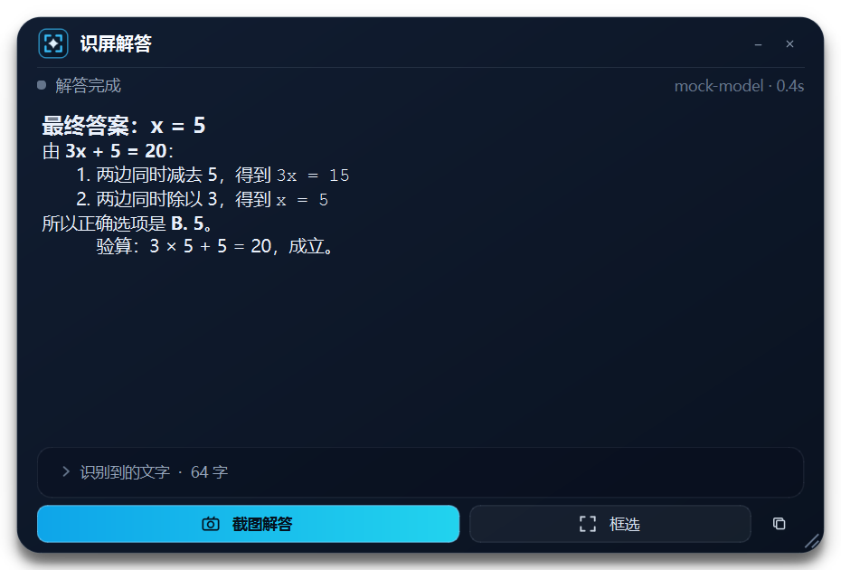

# 识屏解答 · ScreenAnswer

按下快捷键截取屏幕上的题目、试卷、文档或界面，自动识别文字（或直接把图片交给视觉模型），
在一个置顶的小卡片里给出答案。**面向任意屏幕内容**的通用版本：不带任何内置题库，
资料由你自己放进 `know/` 文件夹。

> ScreenAnswer is a lightweight Windows desktop assistant: press a hotkey, it OCRs the
> current screen (or sends the image to a vision model) and streams an answer into an
> always-on-top card. Bring your own OpenAI-compatible endpoint and your own materials.



## 下载

不想装 Python？直接取发行版里的单文件 exe（Windows 10/11 x64，58.9 MB，免安装）：

**[⬇ ScreenAnswer-1.0.0-win64.exe](https://github.com/Saria-Gins/screen-answer/releases/download/v1.0.0/ScreenAnswer-1.0.0-win64.exe)**

SHA-256：`cb1b595e8e1d7327506f07b508c6174a0fe17c9218a7352897579299e197c7e2`

> exe 未签名，首次运行 SmartScreen 可能提示「更多信息 → 仍要运行」。
> 把 `know/` 与 exe 放在同一目录即可加载资料（exe 内置 OCR、PDF 解析，不含任何题库）。

## 功能

- **三种触发方式**：全局快捷键截图 / 框选区域 / 卡片按钮；多显示器按鼠标所在屏幕截取，也可选「所有屏幕」。
- **两种识别方式**：本地 Windows OCR + 文本模型（快、便宜）；或视觉模型直发图片（公式、图表更稳）。
- **本地知识库**：把 `.docx` / `.pdf` / `.txt` / `.md` 放进程序旁的 `know/`，自动切题、建索引、按需检索；
  扫描版 PDF 自动用 Windows OCR 补文本层，结果有缓存，只在第一次慢。
- **隐私模式（防截图）**：卡片、设置窗口、框选层都从截图和录屏里消失（`WDA_EXCLUDEFROMCAPTURE`，
  老系统退化为黑块），带读回校验和守护定时器。
- **深度隐藏**：`Ctrl+Alt+H` 收起 / `Ctrl+Alt+Shift+X` 一键隐身（连托盘图标一起），从 Alt+Tab、Win+Tab 预览中隐藏。
- **可调外观**：透明度、窗口尺寸、答案字号、深色/白底黑字主题，卡片可拖到屏幕任意位置（含屏幕外）。
- **接口无关**：任何 OpenAI 兼容的 `chat/completions`（DeepSeek、OpenAI、Qwen、本地 LM Studio / Ollama…）。

## 快速开始

要求：Windows 10/11、Python 3.10+（在 3.13 上验证）。

```powershell
git clone <your-repo-url> ScreenAnswer
cd ScreenAnswer
python -m venv .venv
.\.venv\Scripts\python.exe -m pip install -r requirements.txt
.\.venv\Scripts\python.exe app.py
```

也可以双击 `启动.bat`（有 `.venv` 就用 `.venv`，否则找系统 `pythonw.exe`）；`调试启动.bat` 会保留控制台看报错。

首次打开后点卡片**左上角图标**进设置，填 API 地址、模型名和 Key：

| 服务 | API 地址 | 模型示例 |
| --- | --- | --- |
| DeepSeek | `https://api.deepseek.com/v1` | `deepseek-chat` |
| OpenAI | `https://api.openai.com/v1` | `gpt-4o-mini` / `gpt-4o` |
| 通义千问 | `https://dashscope.aliyuncs.com/compatible-mode/v1` | `qwen-vl-max` |
| 本地 | `http://127.0.0.1:1234/v1` | 任意模型名（本地地址可不填 Key） |

## 快捷键

| 操作 | 默认按键 |
| --- | --- |
| 截取鼠标所在屏幕 | `Ctrl+Alt+Q` |
| 框选题目区域 | `Ctrl+Alt+S` |
| 显示 / 隐藏卡片 | `Ctrl+Alt+H` |
| 一键隐身（卡片 + 托盘） | `Ctrl+Alt+Shift+X` |

设置 →「快捷键」里可以改成任意组合，要求**至少两个修饰键**（单修饰键太容易被别的软件占用）。
保存时会检测冲突；启动时若主组合被占用，会自动尝试备用组合并在托盘提示。

## 知识库（自带资料）

```
ScreenAnswer/
└─ know/
   ├─ 题库.docx      # 第1题 / 选项 / 【参考答案】… 结构会被识别成问答条目
   ├─ 笔记.md        # 没有题目结构的资料按 ~1200 字切块，作为“资料片段”
   └─ 手册.pdf       # 有文本层直接抽；扫描件用 Windows OCR（单文件最多 60 页 / 150 秒）
```

- 支持 `.docx` / `.pdf` / `.txt` / `.md`；`README`、`_` 开头的说明文件不算资料。
- 解析缓存：`%APPDATA%\ScreenAnswer\kb-cache`（按文件大小+修改时间失效）。
- 检索策略：关键词 IDF 粗筛 + **三字短语证据**双闸门，命中整题权重最高；
  屏幕上的无关文字不会把资料硬塞进提示词。
- 查看索引状态：`ScreenAnswer.exe --knowledge "你的问题"`，
  报告同时写到 `%APPDATA%\ScreenAnswer\knowledge-report.txt`。

## 隐私与隐藏

| 能力 | 说明 |
| --- | --- |
| 防截图 | `SetWindowDisplayAffinity`：Win10 2004+ 完全排除，老系统黑块遮挡；每 2.5 秒自检并补回 |
| 隐藏托盘 | 卡片隐藏时一并隐藏托盘图标（可在设置里关），恢复靠快捷键或重开程序 |
| 任务切换隐藏 | 工具窗口样式 + 关闭 DWM Peek，Alt+Tab / Win+Tab 看不到缩略图 |
| 中性身份 | 放一个 `identity.json` 在 exe 旁即可改显示名，见下 |

截图与 OCR 默认在本机完成，只有识别出的文字（或你选择的整张图片）会发送到你配置的接口。
API Key 用 Windows DPAPI 加密后存到 `%APPDATA%\ScreenAnswer\settings.json`。

`identity.json` 示例（可选，用于把窗口标题、托盘提示改成中性名字）：

```json
{ "display_name": "TextInputHost", "product_name": "Text Input Application" }
```

设置仍是同一个目录，因此改名不影响已有配置。

## 构建 exe

```powershell
.\.venv\Scripts\python.exe -m pip install -r requirements-dev.txt
.\.venv\Scripts\python.exe -m PyInstaller --noconfirm --clean --onefile --windowed `
  --name ScreenAnswer --icon "assets\icon.ico" `
  --version-file "packaging\version_info.txt" `
  --hidden-import winrt --hidden-import winrt.windows.foundation `
  --hidden-import winrt.windows.foundation.collections `
  --hidden-import winrt.windows.globalization `
  --hidden-import winrt.windows.graphics.imaging `
  --hidden-import winrt.windows.media.ocr `
  --hidden-import winrt.windows.storage `
  --hidden-import winrt.windows.storage.streams `
  --hidden-import pypdf --collect-all pypdfium2 app.py
```

产物在 `dist\ScreenAnswer.exe`。把 `know\` 放在 exe 同级目录即可被索引（不入包，方便随时加资料）。

## 目录结构

```
ScreenAnswer/
├─ app.py                     # 入口：托盘、快捷键、截图→OCR→AI 流程
├─ screenanswer/
│  ├─ ai.py                   # OpenAI 兼容接口与流式解析
│  ├─ capture.py              # 截图、DPI/多屏坐标映射
│  ├─ config.py               # 配置、DPAPI 密钥加密、identity.json
│  ├─ hotkey.py               # Win32 全局快捷键
│  ├─ knowledge.py            # docx/pdf/txt/md 解析、检索、缓存
│  ├─ ocr.py                  # Windows 本地 OCR
│  ├─ privacy.py              # 显示保护、任务切换隐藏、守护
│  ├─ shortcuts.py            # 快捷键解析与校验
│  ├─ theme.py                # 配色与样式
│  └─ ui/                     # 卡片、框选层、设置窗口、控件
├─ know/                      # 你的资料（默认空）
├─ tests/test_core.py         # 无依赖单元测试
└─ tools/                     # 诊断脚本（可选）
```

## 测试

```powershell
.\.venv\Scripts\python.exe tests\test_core.py     # 或 python -m pytest
```

## 常见问题

**按快捷键没反应？** 托盘菜单 →「重新注册快捷键」；或换一个双修饰键组合。

**托盘图标消失且快捷键也失效？** 说明开了「隐身时隐藏托盘」并已隐藏：再按一次 `Ctrl+Alt+H`，
或直接重新运行程序（单实例，会把界面唤回来）。

**隐私模式在截图里还有残影？** 部分采集软件（OBS 的 Display Capture 等）用自己的驱动级抓屏，
系统级显示保护对它们无效；设置 →「隐私与隐藏」→「检测当前保护状态」可确认系统侧状态。

**OCR 识别不全？** 放大页面、用框选模式，或改用视觉模型。

**接口 401 / 404？** 检查 API 地址是否带 `/v1`、模型名是否该服务商支持；设置里有「测试连接」。

## 许可

MIT，见 [LICENSE](LICENSE)。第三方组件与许可见 [THIRD_PARTY.md](THIRD_PARTY.md)。

## CI（可选）

`.github/build-workflow.yml.example` 是一份 GitHub Actions 示例（测试 + 打包 exe + 打 tag 时附加到 Release）。
GitHub 对 `.github/workflows/` 下的文件有额外权限要求：需要带 `workflow` 权限的 token 或网页端提交，
所以它默认以示例形式提供 —— 复制到 `.github/workflows/build.yml` 后在网页端提交即可启用。
